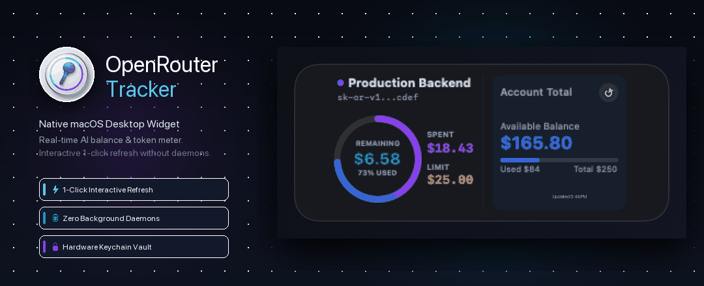
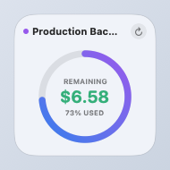
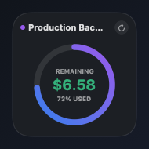
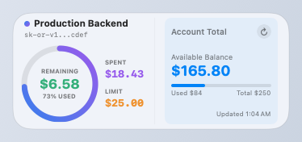
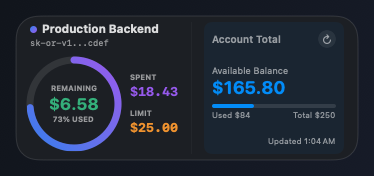
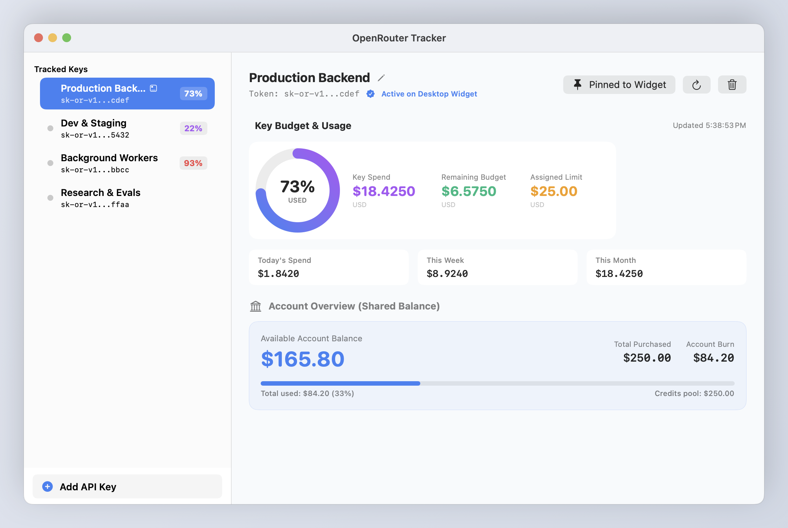
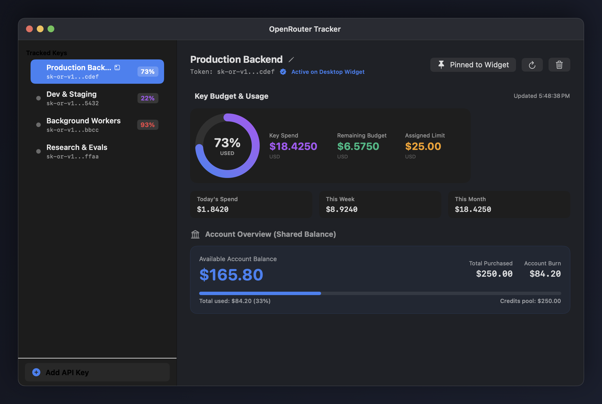

<p align="center">
  
</p>

# OpenRouter Tracker

[](https://apple.com/macos)
[](#windows-installation)
[](https://swift.org)
[](https://www.qt.io/)
[](https://developer.apple.com/xcode/swiftui/)
[](#zero-background-resource-usage)
[](PRIVACY_POLICY.md)
[](LICENSE)
[](https://github.com/vyavahareyash/openrouter-tracker/releases/latest)
[](https://buymeacoffee.com/vyavahareyash)

OpenRouter Tracker is a native macOS and Windows desktop widget and companion app designed for developers, engineering teams, and autonomous AI agents. It gives you instant glanceability over your OpenRouter credit balances, usage pacing, and rate limits directly on your desktop—with **zero background battery drain** and an **interactive 1-click refresh button**.

---

## The "Blind Key" Problem

Developers frequently work with organization-provisioned OpenRouter API keys or separate project tokens without direct access to the web dashboard. You only discover a key has run out of credits when an active build pipeline, local coding agent, or evaluation run crashes mid-flight.

OpenRouter Tracker solves this by placing live, interactive balance gauges right on your macOS desktop:

```text
Glanceable Balance = Real-time Account Balance - Key Spend
```

- **Interactive 1-Click Refresh**: Tap the `🔄` button directly on the desktop widget to instantly query the latest balance in-place via Apple's native `AppIntents`.
- **Zero Background Resource Usage**: Runs **no** background scripts or daemon processes. Apple's system scheduler (`chronod`) manages timeline updates without battery overhead.
- **Hardware Keychain Encryption**: Keys are stored locally using Apple Keychain Services and shared across the sandboxed App Group container. Zero middleman servers or analytics.

---

## Downloads & Installation

> 🪟 **Windows users**: Jump directly to [Option 4: Windows Native App & Desktop Widget](#windows-installation) for the 1-line PowerShell installer or standalone download.

### Option 1: Homebrew (Recommended)

```bash
# Install
brew tap vyavahareyash/tap
brew install --cask openrouter-tracker

# Update & upgrade to the latest release
brew update
brew upgrade --cask openrouter-tracker
```

### Option 2: Direct Download (Pre-built Installers)
- 🍏 **macOS (Universal / Apple Silicon & Intel)**: [Download OpenRouterTracker.dmg](https://github.com/vyavahareyash/openrouter-tracker/releases/latest/download/OpenRouterTracker.dmg)
- 🪟 **Windows (Standalone .EXE)**: [Download OpenRouterTracker.exe](https://github.com/vyavahareyash/openrouter-tracker/releases/latest/download/OpenRouterTracker.exe)
- 🪟 **Windows (Portable ZIP)**: [Download OpenRouterTracker-windows-x64.zip](https://github.com/vyavahareyash/openrouter-tracker/releases/latest/download/OpenRouterTracker-windows-x64.zip)

---

### 🛡️ First-Launch & macOS Security Prompts

#### 1. Gatekeeper ("App is damaged" or "Unidentified Developer")
Because this open-source release is ad-hoc signed rather than signed with a paid ($99/year) Apple Developer certificate, macOS Gatekeeper may intercept the first launch.

You only need to allow it **once**:
- **Quick Terminal Fix** (Recommended):
  ```bash
  xattr -cr /Applications/OpenRouterTracker.app
  ```
- **Or via Finder**: In `/Applications`, **Control-click (or Right-click)** `OpenRouterTracker.app` → select **Open** → click **Open** in the alert dialog.
- **Or via System Settings**: Go to **System Settings > Privacy & Security**, scroll down to the Security section, and click **Open Anyway**.

#### 2. macOS Keychain Access Prompt ("OpenRouter Tracker wants to use your login keychain")
When you save an API key, macOS prompts for your login password with:
> *"OpenRouter Tracker wants to use the 'login' keychain. Type the password for this user to allow this."*

- **Why this happens**: OpenRouter Tracker never stores your raw API keys in plain text files. Instead, it delegates security to **Apple's Hardware Keychain Services (`kSecClassGenericPassword`)** with AES-256 encryption. macOS confirms your Mac user password to grant access to the secure enclave item.
- **What to click**: Enter your Mac user password and click **"Always Allow"** so the companion app and the desktop widget can seamlessly access the key without re-prompting on every widget refresh.

### Option 3: Build From Source
```bash
# Clone the repository
git clone https://github.com/vyavahareyash/openrouter-tracker.git
cd openrouter-tracker

# Clean build and bundle the app & widget
./build.sh

# Launch the app
open build/OpenRouterTracker.app
```

<a id="windows-installation"></a>
### Option 4: Windows Native App & Desktop Widget (Recommended for Windows)

No repository cloning or developer tools required!

#### Method A: 1-Line PowerShell Web Installer (Zero Clone)
Run the following in PowerShell to automatically download the latest release and create Start Menu shortcuts:
```powershell
irm https://raw.githubusercontent.com/vyavahareyash/openrouter-tracker/main/scripts/install.ps1 | iex
```

#### Method B: Standalone Download (No Install Required)
1. Download [OpenRouterTracker.exe](https://github.com/vyavahareyash/openrouter-tracker/releases/latest/download/OpenRouterTracker.exe) (or [OpenRouterTracker-windows-x64.zip](https://github.com/vyavahareyash/openrouter-tracker/releases/latest/download/OpenRouterTracker-windows-x64.zip)).
2. Double-click `OpenRouterTracker.exe` to run immediately.

#### Method C: Run from Source / Developer Mode
```powershell
# 1. Install dependencies
pip install -r windows/requirements.txt

# 2. Launch
.\run_windows.bat

# Or directly with Python flags:
python windows/main.py             # Launches Companion App + Desktop Widget + System Tray
python windows/main.py --widget-only # Launches only Desktop Widget and System Tray
python windows/main.py --app-only    # Launches only Companion App
```

- **Desktop Widget**: Frameless, translucent, draggable anywhere on your desktop. Supports both **Small** (radial donut gauge) and **Medium** (key metrics + account pool burn bar) sizes.
- **Tactile 1-Click Refresh**: Tap the `🔄` button directly on the desktop widget to instantly query the latest balance in-place.
- **Companion App**: Full multi-key manager, inline nickname renaming, budget gauges, periodic spend velocity (Today/Week/Month), and live key testing before saving.
- **Windows System Tray**: Notification area icon (`QSystemTrayIcon`) with right-click menu to switch active widget keys, resize widgets, or refresh balances.
- **Windows DPAPI Security**: API keys are securely encrypted at rest per-user via Windows Data Protection API (`win32crypt.CryptProtectData`).
- **Compile Standalone Executable**: Run `.\build_windows.bat` to package into a standalone binary with PyInstaller.

<a id="windows-method"></a>
### Option 5: Legacy Standalone Script (Headless / Linux / CLI)
For users on Windows, Linux, or headless environments who do not want to install the macOS desktop application, use the legacy standalone terminal script:

```bash
# 1. (Optional) Configure .env from template
cp .env.example .env       # Windows: copy .env.example .env

# 2. Run script (reads .env, environment variable, or inline argument)
python3 scripts/check_usage.py [YOUR_KEY]
```
- **Zero Dependencies**: Uses standard Python 3 libraries (`urllib`, `json`), with auto-fallback to `requests` and `python-dotenv` if installed.
- **Cross-Platform**: Works identically on Windows (`python scripts\check_usage.py`), macOS, and Linux.
- **Template Included**: Root [`.env.example`](.env.example) is ready to copy into `.env`.

---

## Key Features

- ⚡ **1-Click Interactive Widget Refresh**: Tap the `🔄` button directly on the desktop widget to update balances in-place in < 500ms without opening the host application (powered by native `AppIntents` on macOS and asynchronous non-blocking thread workers on Windows).
- 🔋 **Zero Idle Resource Overhead**: Uses 0% idle CPU cycles and no polling battery drain. Managed by system scheduler (`chronod`) on macOS and an event-driven Qt loop on Windows.
- 🖥️ **Dual Widget Sizes (Small & Medium)**: Choose between **Small** (compact radial donut gauge and remaining balance) and **Medium** (dual-column view with key budget gauges, limit counters, and account pool burn bar).
- 🔑 **Multi-Key Management**: Add, name, test, and monitor multiple organization or project keys with inline renaming and 1-click active widget key designation.
- 🔐 **Hardware-Backed Credential Encryption**: Keys are never stored in plain text. Encrypted using **Apple Keychain Services (`kSecClassGenericPassword`)** on macOS and **Windows DPAPI (`win32crypt.CryptProtectData`)** on Windows.
- 🪟 **Windows System Tray Integration**: Compact tray icon in the Windows notification area with instant context actions (toggle companion app, toggle widget, switch size, refresh, and switch active key).
- 📊 **Glanceable Velocity & Limits**: View real-time daily, weekly, and monthly spending velocity alongside total account pool depletion.

---

## Visual Showcase

<table>
  <tr>
    <td align="center"><b>Small Widget (Light)</b></td>
    <td align="center"><b>Small Widget (Dark)</b></td>
  </tr>
  <tr>
    <td></td>
    <td></td>
  </tr>
  <tr>
    <td align="center"><b>Medium Widget (Light)</b></td>
    <td align="center"><b>Medium Widget (Dark)</b></td>
  </tr>
  <tr>
    <td></td>
    <td></td>
  </tr>
  <tr>
    <td align="center"><b>Companion App (Light)</b></td>
    <td align="center"><b>Companion App (Dark)</b></td>
  </tr>
  <tr>
    <td></td>
    <td></td>
  </tr>
</table>

> 📸 **Interactive Gallery**: View the full responsive screenshot comparison in the [Screenshot Gallery](screenshots/index.html).

---

## Using the Widget on Your Desktop

### 🍏 On macOS (Sonoma 14+)
1. Open **OpenRouter Tracker** once and add your API key (`sk-or-v1-...`).
2. Right-click any open area on your macOS Desktop and select **"Edit Widgets..."**.
3. Search for **"OpenRouter"** in the widget gallery.
4. Drag either the **Small** or **Medium** widget onto your desktop or Notification Center.

### 🪟 On Windows (10 & 11)
1. Run OpenRouter Tracker via the [1-line installer](#windows-installation), standalone `OpenRouterTracker.exe`, or `.\run_windows.bat`.
2. Add your OpenRouter API key in the Companion Application.
3. The frameless desktop widget appears automatically:
   - **Move**: Click and drag anywhere on the widget to reposition it. Its desktop coordinates are saved automatically.
   - **Switch Size**: Right-click the widget and select **"Switch to Small Widget"** or **"Switch to Medium Widget"**.
   - **Pin to Desktop / Always on Top**: Right-click to toggle **"Always on Top"** or pin it behind active workspace windows.
   - **System Tray**: Right-click the OpenRouter Tracker icon in the Windows taskbar notification area to quickly refresh balances, switch active keys, or toggle visibility.

---

## Documentation

Full architectural specifications, developer guides, and user manuals are organized in the [`docs/`](docs/INDEX.md) hub:

- [User Feature Guide](docs/user/FEATURE_GUIDE.md) — Walkthrough of all app capabilities, widget sizes, and multi-key workflows.
- [Onboarding & FAQ](docs/user/FAQ_AND_ONBOARDING.md) — 3-step setup guide, troubleshooting blank widgets, and FAQs.
- [Security & API Key Management](docs/user/SECURITY_AND_KEYS.md) — Keychain architecture, sandboxing, and token safety.
- [System Architecture](docs/engineering/ARCHITECTURE.md) — Module catalog, App Group IPC, AppIntents lifecycle, and Mermaid diagrams.
- [Calculations & Formulas](docs/engineering/CALCULATIONS.md) — Mathematical formulas for usage burn rate and depletion thresholds.
- [Developer Guide](docs/engineering/DEVELOPMENT.md) — CLI build scripts, testing with coverage, and packaging DMGs.
- [Product Specifications](docs/product/SPECIFICATION.md) — OpenRouter API schemas and offline resilience invariants.
- [Product Roadmap](docs/product/ROADMAP.md) — Upcoming features (Menu Bar status item, low balance alerts).
- [Architecture Decision Records (ADR)](docs/adr/) — Technical decisions behind App Group storage and AppIntents.

---

## Private by Default

OpenRouter Tracker makes **zero network calls** to any third-party analytics, tracking, or intermediary server. Outbound HTTPS traffic connects exclusively to official OpenRouter endpoints (`https://openrouter.ai/api/v1/*`). Review our formal [Privacy Policy](PRIVACY_POLICY.md).

---

## Support Development

OpenRouter Tracker is 100% free, private, and open-source with zero ads, zero trackers, and zero subscriptions. If OpenRouter Tracker helps you keep track of your API balance and budget, buying a coffee or sponsoring development is greatly appreciated!

<a href="https://buymeacoffee.com/vyavahareyash" target="_blank">
  
</a>

---

## License

This project is licensed under the [MIT License](LICENSE).
